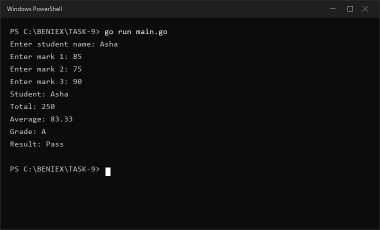

# Student Grade Calculator (Go Fundamentals)

A command-line student grade calculation program written in Go, built as part of the **Go Programming: The Fundamentals** assessment.

## Features

- **Interactive Input:** Reads student name and 3 subject marks using `fmt.Scanln`.
- **Validation:** Ensures each mark entered is an integer within the range `0–100`.
- **Dynamic Collection:** Stores marks in a slice and calculates sums using Go's `range` keyword.
- **Statistical Calculation:** Calculates total marks and average score using modular functions.
- **Grade Assignment:** Assigns letter grades based on criteria:
  - **A:** Average $\ge$ 80
  - **B:** Average $\ge$ 60
  - **C:** Average $\ge$ 40
  - **F:** Average $<$ 40
- **Result Status:** Displays `Pass` if average $\ge$ 40, otherwise `Fail`.

## Execution & Output

```text
Enter student name: Asha
Enter mark 1: 85
Enter mark 2: 75
Enter mark 3: 90
Student: Asha
Total: 250
Average: 83.33
Grade: A
Result: Pass
```

## Running the Program

To run the program locally:

```bash
# Format source code
go fmt ./...

# Run the application
go run main.go
```

## Screenshot


